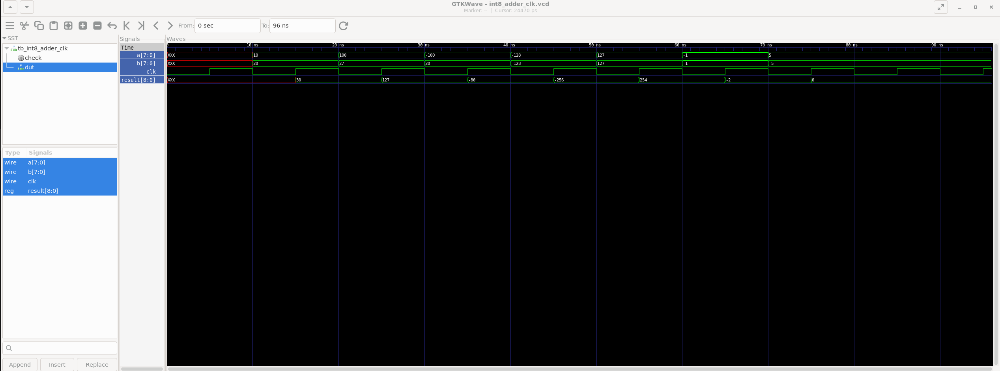
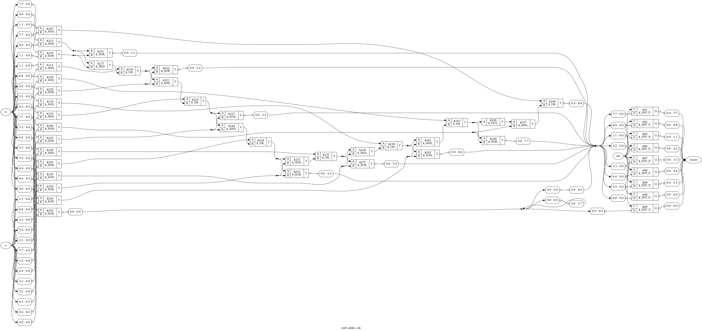

# INT8 Adder: RTL to Gates

A signed 8-bit adder written in **Verilog**, verified with a self-checking testbench,
and synthesized with **Yosys** down to 38 logic gates + 9 flip-flops.
The synthesized gate-level netlist passes the same tests as the RTL.

| | |
|---|---|
| **Inputs** | `a`, `b`: signed 8-bit (−128 … +127) |
| **Output** | `result`: signed 9-bit (−256 … +254) |
| **Latency** | 1 clock cycle (registered output) |
| **Verification** | 7/7 PASS (RTL) · 7/7 PASS (gate-level) |
| **Synthesis** | 47 cells = 38 gates + 9 flip-flops |

## Block diagram

```
             +----------------------------+  sum[8:0]  +---------+
 a[7:0] ---->|  signed ripple-carry adder |----------->|  9 DFFs |----> result[8:0]
 b[7:0] ---->|  (38 gates)                |            +---------+
             +----------------------------+                 ^
 clk -------------------------------------------------------+
```

On every rising edge of `clk`, `result` captures `a + b`.

## Why 9 bits?

| Case | Sum | Fits in 8 bits? |
|---|---|---|
| 127 + 127 | 254 | ❌ (8-bit max is 127) |
| −128 + −128 | −256 | ❌ (8-bit min is −128) |

The sum of two signed 8-bit numbers needs **9 bits** to never overflow.
Because `a`, `b` and `result` are declared `signed`, Verilog **sign-extends** the
inputs to 9 bits before adding. For example, −128 = `1000_0000` becomes `1_1000_0000`.

## Results

### 1. RTL simulation: 7/7 PASS

```
t=  16 ns  A=  10 B=  20 RESULT=  30 (bits 000011110)  PASS
t=  26 ns  A= 100 B=  27 RESULT= 127 (bits 001111111)  PASS
t=  36 ns  A=-100 B=  20 RESULT= -80 (bits 110110000)  PASS
t=  46 ns  A=-128 B=-128 RESULT=-256 (bits 100000000)  PASS
t=  56 ns  A= 127 B= 127 RESULT= 254 (bits 011111110)  PASS
t=  66 ns  A=  -1 B=  -1 RESULT=  -2 (bits 111111110)  PASS
t=  76 ns  A=   5 B=  -5 RESULT=   0 (bits 000000000)  PASS
7 of 7 passed
```

The testbench:
- changes `a` and `b` on the **falling** edge (5 ns away from every rising edge, so no setup/hold risk)
- waits **exactly one** rising edge, then checks `result`, so it verifies the **1-cycle latency** too
- prints PASS/FAIL for each case and a final count

### 2. Waveform (GTKWave)



Inputs change at the falling edges (10, 20, 30 … ns); `result` updates at the next rising edge (15, 25, 35 … ns).

### 3. Synthesis (Yosys, `abc -g simple`)

| Cell | Count | Role |
|---|---|---|
| `$_XOR_` | 15 | sum bits |
| `$_AND_` | 15 | carry generation |
| `$_OR_` | 7 | carry propagation |
| `$_NOT_` | 1 | sign bit (bit 8) |
| `$_DFF_P_` | 9 | `result` register (one per bit) |
| **Total** | **47** | 38 logic gates + 9 flip-flops |

Yosys built a **ripple-carry adder**: a half adder for bit 0, full adders for bits 1–7,
and a final stage that computes the **sign bit** (that's where the single NOT gate comes from).

### 4. Gate diagram



Left: input bits of `a` and `b`. Middle: the carry chain rippling bit by bit.
Right: 9 flip-flops clocked by `clk`, driving `result`.

### 5. Gate-level simulation: 7/7 PASS

The synthesized netlist (`synthesized.v`) was run through the **same testbench**
and gave identical results, which proves synthesis preserved the design's behaviour.

## How to run

**Tools** (Ubuntu / WSL):
```bash
sudo apt install iverilog gtkwave yosys graphviz
```

**RTL simulation:**
```bash
iverilog -o sim rtl/int8_adder_clk.v tb/tb_int8_adder_clk.v
vvp sim
```

**View the waveform:**
```bash
gtkwave int8_adder_clk.vcd tb/int8_adder_clk.gtkw
```

**Synthesis + gate diagram:**
```bash
yosys -s synth/synth.ys
dot -Tpng synth/int8_adder_clk.dot -o docs/gates.png
```

**Gate-level simulation:**
```bash
iverilog -o sim_gl synth/synthesized.v tb/tb_int8_adder_clk.v
vvp sim_gl
```

## Repo structure

```
rtl/    int8_adder_clk.v       design
tb/     tb_int8_adder_clk.v    self-checking testbench
        int8_adder_clk.gtkw    GTKWave signal layout
synth/  synth.ys               Yosys synthesis script
docs/   waveform.png, gates.png
```

## Learning Outcomes

- **`signed` matters:** without it, −128 + −128 is computed wrong because Verilog pads with 0s instead of sign-extending.
- **Flip-flops use `<=`** (non-blocking) inside `always @(posedge clk)`.
- **Latency** is counted in clock cycles: this design is 1 cycle, which is 10 ns at 100 MHz.
- **Testbench timing:** inputs should change away from the clock edge, otherwise setup/hold rules are broken.
- **One line of RTL becomes real hardware:** `a + b` became a 38-gate ripple-carry adder.
- **RTL sim vs gate-level sim:** running the netlist through the same testbench confirms synthesis didn't change the logic.


---
Author: [sushruthks](https://github.com/sushruthks) · 1st-year ECE